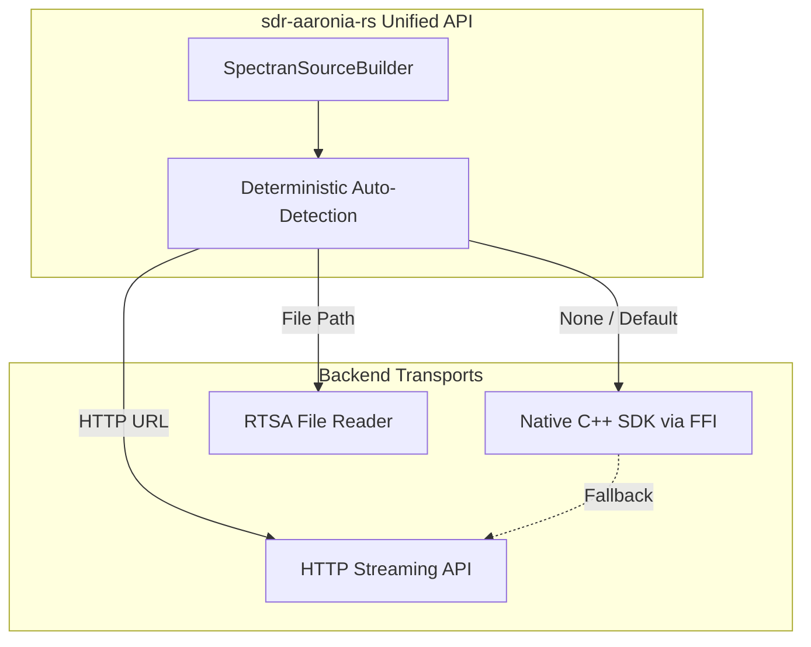

# Design: Unified Aaronia SDR Interface (sdr-aaronia-rs)

This document describes the architecture of the `sdr-aaronia-rs` crate, which provides a unified interface to Aaronia Spectran V6 devices across the native SDK, the HTTP streaming API, and offline RTSA files.

## 1. Overview

The Aaronia ecosystem offers three ways to access Spectran hardware: the native RTSA-Suite PRO SDK, the HTTP streaming API, and recorded RTSA files. This crate wraps all three behind a single deterministic facade, `SpectranSource`, so callers can work with Aaronia hardware without depending on the underlying transport.

## 2. Architecture

The crate is built around an automatic source-detection router that instantiates the correct backend from the provided configuration.



## 3. Source Selection

`SpectranSource::new(config)` selects a backend using strict, deterministic rules:

| Configuration | Backend | Fallback | Platforms |
|---|---|---|---|
| `SpectranConfig::from_file("recording.rtsa")` | File | None — fails if the file is missing | All |
| `SpectranConfig::from_http("http://192.168.1.100")` | HTTP | None — fails if unreachable | All |
| `SpectranConfig::default()` (nothing specified) | Native SDK, when the `native-sdk` feature is enabled and the SDK library is found | Connects to the default HTTP endpoint (`http://localhost:42664`; older saved RTSA missions use port `54664`) otherwise. Since `native-sdk` is not a default feature, a stock build always resolves to HTTP. | All (SDK itself is Windows/Linux only) |
| Force option, e.g. `config.force_native_sdk()` | Forced type | None — fails if unavailable | Depends on forced type |

## 4. Backend Implementations

### 4.1 Native SDK

Available on Windows and Linux only, behind the non-default `native-sdk` feature.

- Uses direct FFI calls into the Aaronia RTSA-Suite PRO shared library (`AaroniaRTSAAPI.dll` / `libAaroniaRTSAAPI.so`). The `spectranv6` and `spectranv6eco` strings are device-family identifiers passed when enumerating and opening devices, not library names.
- **IQ mode constraint**: enforces `span * 1.5 <= receiverclock` by reading the live device clock before streaming.
- **Data path (RX)**: polls `GetPacket` on the C++ side every 5 ms. Where the packet stride allows, the raw sample buffer is reinterpreted in place as `Complex32` (no per-sample conversion) before being copied into the caller's buffer.
- **Data path (TX)**: provides an experimental `TxStream` API built on `SendPacket`. This path is hardware-unverified pending full V6 testing, as the ECO model lacks TX.
- **Sweep-spectra mode**: configures non-IQ sweeping via `SweepsaConfig` by modifying `"main/startfreq"`, `"main/stopfreq"`, `"main/rbwfreq"` and `"main/reflevel"`. These key names match Aaronia's own `SweepSpectrumEco` sample; the code previously sent `"main/rbw"`, which no sample uses. Supports the `"spectranv6/sweepsa"` and `"spectranv6eco/sweepsa"` open strings, both of which the samples confirm. The path itself remains hardware-unverified.
- **Health and GPS telemetry**: exposes `HealthState` and `GpsState` structs populated by a recursive configuration tree-walker (`walk_health_tree`) that fetches device diagnostics dynamically. Not yet exercised against live hardware.

### 4.2 HTTP Streaming

- Implements the V9 RTSA HTTP specification.
- Supports Basic Auth and token-based authentication.
- **Formats**: supports the `Json`, `Int16`, `Float16`, and `Float32` wire formats, maintaining a persistent chunked-transfer buffer across packet boundaries. The default is `Float32` (binary, lossless); `Int16` is opt-in via `SpectranConfig::stream_format()` / `stream_scale()`.
- Beyond streaming, `HttpEndpointsClient` exposes device control and health telemetry (as a generic configuration tree) within a headless Rust process.

#### The stream engine

Both HTTP front-ends — `SpectranSource`'s HTTP backend and the FutureSDR `HttpSource` block — run on one internal stream engine, `HttpStreamEngine` in `src/http_engine.rs`. It owns everything between the socket and an IQ packet:

- **Opening** `/stream` through `HttpEndpointsClient::open_stream`, the crate's one `/stream` request (`start_stream` uses it too): the response headers must arrive within 5 s.
- **Reading** on a task per connection that drains the body into a 64-chunk channel — the backpressure point — and gives the connection up when it delivers no bytes for 5 s (a hung server, a half-open TCP connection).
- **Decoding** with `StreamParser::process_data_recovering`, so an undecodable packet costs only itself, and a `DropDetector` over the IQ packets. Each chunk comes back as events in stream order: IQ packets, skipped non-IQ packets, and breaks — a server gap, a backward timestamp step, a lost packet, or a reconnect.
- **Reconnecting** under the front-end's `ReconnectPolicy` (first delay, ceiling, attempt budget, and the uptime that earns the budget back). Before each reconnect attempt it re-applies the tuning the front-end shares with it, as a full `/control` capture tuple; around each connection it can write the `/control` streaming start and stop. While the shared `listen_only` flag is set it writes nothing.
- **Restarting** on request, for a front-end that picks up a retune by reconnecting.

The engine has no task of its own: the front-end polls it for chunks (which is where a lost connection is noticed and the next one opened) and decodes them. What differs between the two front-ends is configuration and what they do with the packets:

| | `SpectranSource` (HTTP) | `HttpSource` (FutureSDR) |
|---|---|---|
| Drives the engine from | a spawned reader task feeding `read_samples` | `work()`, parking at most 20 ms at a time |
| Reconnect policy | 250 ms doubling to 4 s, 5 attempts, budget back after 30 s up; none with `auto_reconnect(false)` | every 1 s, unlimited — a source block that gave up would end the flowgraph's input |
| Re-tune before a reconnect | the current tuning, unless `listen_only` | never: a reconnect must not undo an external retune |
| `/control` streaming start/stop around connections | no | yes, unless `listen_only` |
| First tune | `/control` capture tuple, retried, at construction | `/remoteconfig` with read-back, `/control` fallback, first start only |
| Retune | `/control` PUT; reads stop at the packet where the geometry changes | external, then `restart_pending` restarts the stream |
| Breaks surface as | read boundaries plus `take_overrun()` | `StreamBreakSink` indices and `StreamStats` counters |

### 4.3 RTSA Files

- Maps the RTSA file format to the `SdrSource` interface.
- Extracts metadata (frequency, sample rate) directly from the file.
- Single-channel only; retuning is inherently unsupported for pre-recorded captures.

## 5. Channel Hopping and Dwell Control

Retuning mid-stream is `SpectranSource::set_center_frequency_hz`, per backend:

- **Native SDK**: re-issues `configure_iq_receiver` with the new center frequency, applying the change to the open device handle via the `main/centerfreq` configuration key. No stream restart is required.
- **HTTP**: `SpectranSource::set_center_frequency_hz` wraps `HttpEndpointsClient::configure_capture` as a `PUT` to the license-free `/control` endpoint, always sending the complete capture tuple (center, span, reference level) with unchanged values filled from the cached config. The full tuple is required: RTSA servers silently ignore a capture `PUT` carrying only one of the two frequency fields (it returns `{"success":true}` but the device stays put — live-verified). Hopping deliberately avoids `/remoteconfig` and is not gated on the license probe. (Whether that path needs the "Remote Config" license at all is unconfirmed: a system without the license accepted `/remoteconfig` writes in testing. See docs/HTTPSPEC.md.)
- **File**: not supported.

The hop loop itself — which channel next, how long to dwell there, and the ~75 ms settle after a retune that rides out the RTSA's apply-config latency and flushes stale samples — is the consumer's. Until 0.12.0 this crate carried one behind the `sdr-source` feature (`SpectranSdrSource`, an implementation of `orecchiette-sdr-source-rs`'s `SdrSource` trait); it lives beside its consumer now (Specola's `sdr-aaronia-source`), and a caller with its own trait builds the same thing from `SpectranSourceBuilder`.

## 6. Overrun Detection and Fault Handling

Over HTTP, every break the stream engine reports — a server gap or backward step from the `DropDetector` over each packet's `start_time`/`end_time`, a packet the parser could not decode, or a reconnect — marks the next IQ packet. A read never spans one: assembly stops before the marked packet, and the read that begins with it latches `SpectranSource::pending_overrun`, which `take_overrun()` reads and clears. A consumer that resets its state between reads therefore resets exactly at the break (Specola's adapter sets its `IqPacket::overrun` from it). A break before the first packet the source ever delivered is not reported: nothing precedes it.

The native-SDK backend latches the same flag from its packets' overflow, dropped and time-discontinuity warning flags. File sources always report `false`.

## 7. FutureSDR Integration

FutureSDR integration is available under the `futuresdr` feature gate. The crate exposes lower-level builder variants (e.g. `HttpSourceBuilder`) so `HttpSource` can be used as a source block in FutureSDR flowgraphs. The block streams through the same engine as `SpectranSource` (§4.2) and adds what a flowgraph source needs: a sample buffer sized to the downstream buffer and the engine's sweep, stream-break indices in its own output, the passive link-budget check, and shared `StreamStats`:

```text
┌─────────────────┐    ┌────────────────────┐
│   FutureSDR     │    │  sdr-aaronia-rs    │
│   Flowgraph     │    │    (Source API)    │
├─────────────────┤    ├────────────────────┤
│ HttpSource      │◄──►│ HttpSourceBuilder  │
│ (Block)         │    │ StreamFormat       │
│                 │    │ HttpStreamEngine   │
└─────────────────┘    └────────────────────┘
```
